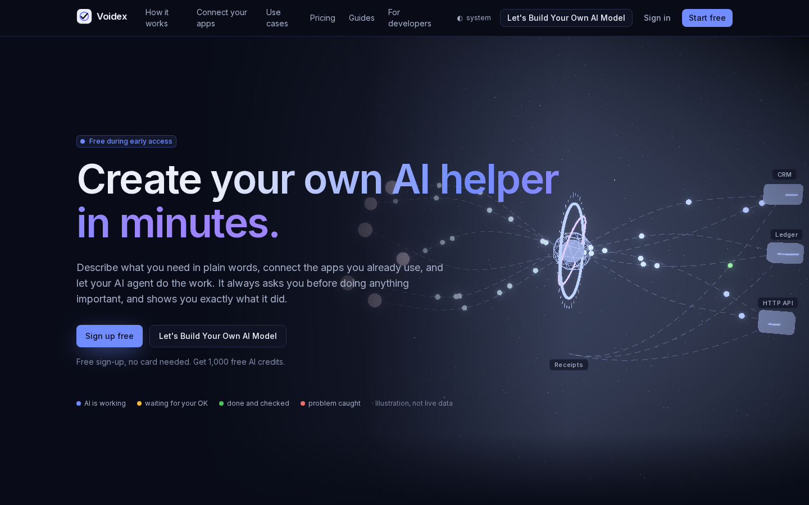
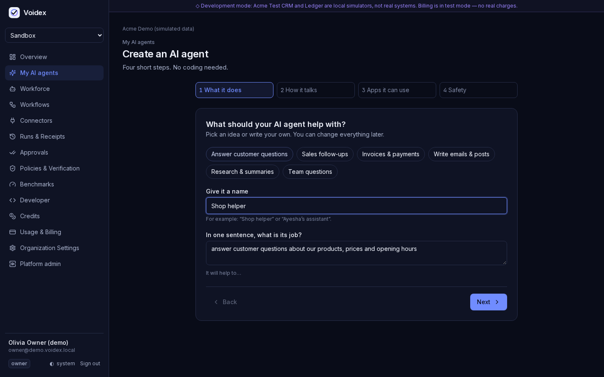
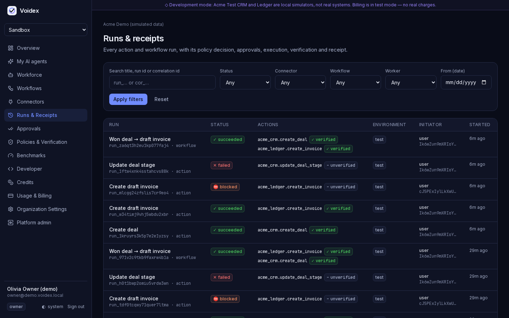
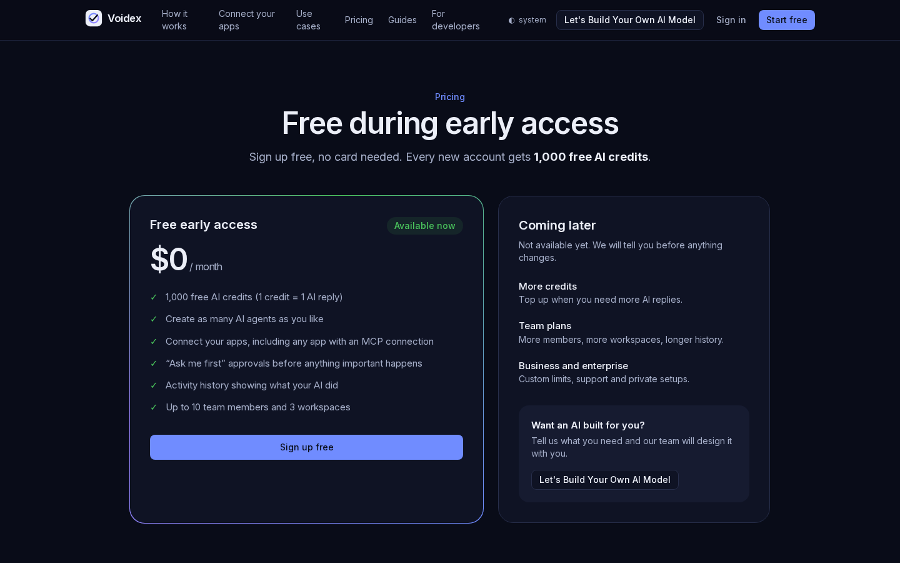
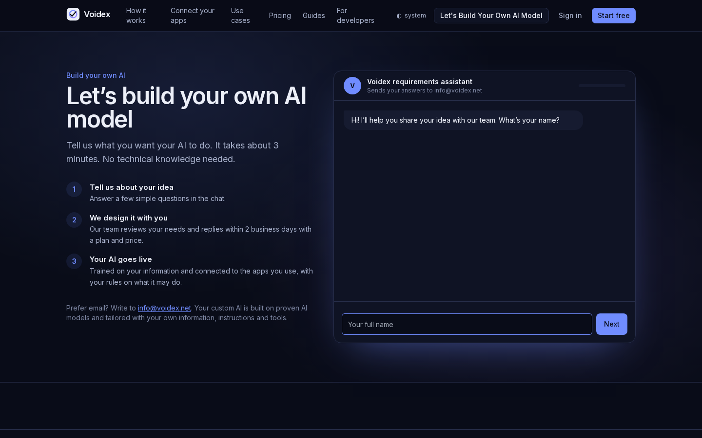

# Voidex

**Create your own AI helper in minutes — no coding needed.**

Voidex lets anyone build an AI agent that works with the apps they already use. Describe the job in plain words, connect your apps, and the agent does the work. It **asks before doing anything important** and **shows exactly what it did**.

🌐 **Live:** [voidex.net](https://voidex.net) · ✉️ **Contact:** info@voidex.net · 📅 Established 2025

> Free during early access: free sign-up, no card needed, and every account gets **1,000 free AI credits** (1 credit = 1 AI reply).

## What you can do

- **Build an AI agent in 4 steps.** Say what it does, how it talks, which apps it can use, and how careful it should be.
- **Connect your apps.** Agents act in connected tools through one controlled path.
- **Ask me first.** Anything that sends, changes or deletes data waits for a person's OK.
- **See what happened.** Every action is checked against the real system afterwards, and you get a receipt that can't be quietly edited.
- **Build your own AI with us.** Tell us your requirements and the Voidex team designs a custom AI solution for you.

## How it works behind the scenes

Every action an AI agent wants to take goes through the same steps:

1. **Policy:** deny by default; your workspace safety rules decide what is allowed.
2. **Approval:** sensitive actions wait for a person. The approval is tied to the exact request, so nothing can change after it is approved.
3. **Execute:** the action runs in an isolated worker.
4. **Verify:** Voidex reads the real system again to confirm what actually happened. An AI saying "done" is never taken as proof.
5. **Receipt:** a tamper-evident record of who asked, who approved, what ran, and what was confirmed.

Screenshot from the demo workspace: it uses built-in practice apps (simulated CRM and ledger), not real customer systems.

## Plans

## Want a custom AI?

[Tell us what you need →](https://voidex.net/build-your-ai)

---

This repository is a public overview. Voidex's source code is private.
© 2025–2026 Voidex. All rights reserved.
